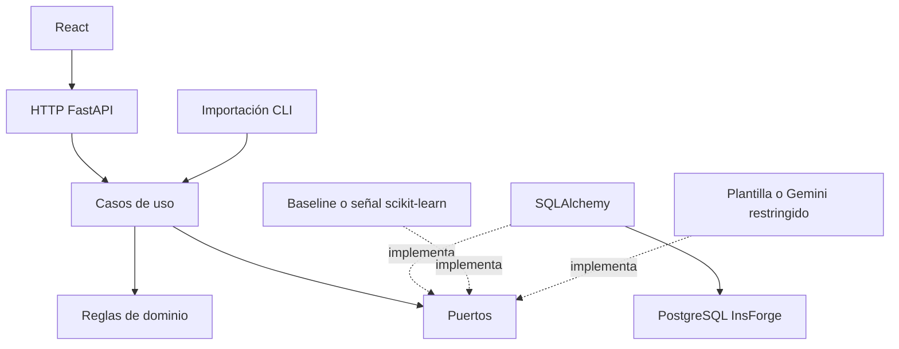

# Arquitectura y decisión de alcance

La solicitud inicial .md se ajusta a la corrección posterior: comparar carreras antes de instituciones/sedes, 12 criterios y distritos específicos. Nueve páginas de negocio; el historial forma parte de Mi cuenta.

- domain: comparación, afinidad, factibilidad y errores; sin frameworks.
- application: casos de uso y protocolos; no importa adaptadores concretos.
- adapters/inbound: HTTP y CLI.
- adapters/outbound: repositorios SQL, seguridad, baseline, artefacto y explicaciones.
- infrastructure: conexión/configuración y composición.
- packages/orienta_features: transformación compartida por entrenamiento e inferencia.

Persistencia inicial compacta: career (programa normalizado y perfil versionado), institution, offer (sede/modalidad y procedencia), legacy_code, import_batch, app_user, browser_session, comparison y feedback. Se conserva el mapeo de carrera_codigo mediante diccionarios y fila original en offer.detail; la PK career.code corresponde a grupo_carrera_codigo. No confundir esos namespaces.

JSON almacena contenido editorial, snapshot y esquema de respuestas inmutable de cada comparación. Las identidades y relaciones principales tienen claves/FK/índices SQL. Una normalización posterior de evidencias/perfiles puede migrarse sin cambiar dominio/API.

La primera migración congela DDL estático; no importa modelos cambiantes al reproducirse. Todo vive en esquema orienta, no en public ni en tablas Auth del proveedor.

La afinidad inicial usa distancias entre seis dimensiones y pesos iguales. Es una rúbrica explícita, no una probabilidad. Presupuesto/distrito/modalidad se evalúan por oferta, fuera del interés. Valores ausentes nunca se convierten en cero. Perfil no revisado: solo demostración etiquetada o exploración sin índice.

El directorio se almacena en `institution_directory`, separado de `institution` y `offer` para no inferir programas desde una ubicación. Los comandos de importación y revisión son tareas administrativas. Gemini genera narrativas estructuradas con el contexto de respuestas y catálogo, mientras el dominio conserva la autoridad sobre afinidad y presupuesto. Véase [alcance](experiencia-ia-instituciones.md).

La inferencia de contenido implementa el puerto `ContentRecommender`. Se entrena TF-IDF offline y se entrega un artefacto JSON con hash; FastAPI lo carga una vez por proceso. `institutional_program` relaciona planes documentados con la carrera normalizada y el directorio, sin alterar las identidades del legado. La versión pública incorpora los datos efectivos de ofertas y programas, y la versión del par es un hash fijo.
